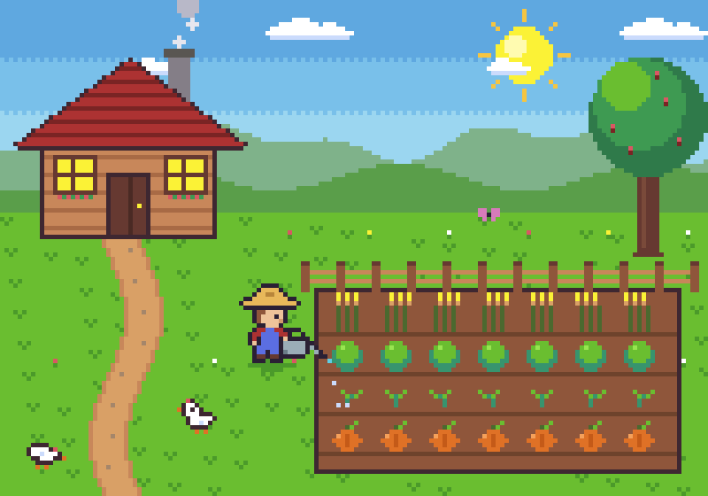

# Aseprite Plugin for Claude Code

**Claude draws and animates pixel art in [Aseprite](https://www.aseprite.org/), live in the window you have open.**

Ask for a sprite, a scene or an animation. Every step appears on your canvas as Claude works: the sky, then the hills, then the tree. Ctrl+Z undoes one Claude step at a time, and you can edit alongside it.



```
/plugin marketplace add OpenScaleOrg/Aseprite-Plugin
/plugin install aseprite@openscale
```

[](LICENSE)


---

## Why this plugin

Most Aseprite integrations run a hidden copy of Aseprite and write the result to disk, so nothing changes in the window you're looking at until you reopen the file. This plugin connects to your **running** Aseprite instead.

| | This plugin | Typical Aseprite MCP servers |
|---|---|---|
| Draws in the window you have open | ✅ live, step by step | ❌ edits the file on disk |
| Undo Claude's work with Ctrl+Z | ✅ one undo per step | ❌ |
| Works on an unsaved tab | ✅ | ❌ |
| You and Claude edit the same canvas | ✅ | ❌ |
| Works with Aseprite closed | ✅ falls back to batch mode | ✅ |
| Pixel-art skills (palette, shading, animation, dithering, export) | ✅ 5 | varies |
| Slash commands | ✅ 5 | varies |
| Setup | Automatic: the Aseprite extension installs itself and the Aseprite path is detected | Usually a config file with the Aseprite path |

## Quick start

**You need** [Aseprite](https://www.aseprite.org/) 1.3 or later (Steam, itch.io or a self-built copy all work), [Claude Code](https://claude.com/claude-code), and [uv](https://docs.astral.sh/uv/getting-started/installation/). uv fetches Python by itself.

1. **Install the plugin** in Claude Code:
   ```
   /plugin marketplace add OpenScaleOrg/Aseprite-Plugin
   /plugin install aseprite@openscale
   ```
2. **Start a new Claude session.** The plugin installs its small Aseprite extension automatically.
3. **Restart Aseprite once** so it loads the extension, then open or create a sprite.
4. **Allow access when Aseprite asks.** On first use, Aseprite asks whether the script may use the network and write files. Tick *Don't show this alert again* and click Allow.
5. **Run `/pixel-setup`** to check that everything is connected, then ask for something.

## What you can ask

> Draw a 32×32 health potion with a cork and a glass highlight.

> Animate a campfire loop in my open file: 8 frames, flickering flames and rising sparks.

> Make my character a 6-frame idle breathing animation and export a spritesheet for Godot.

> Recolour this sprite to the Game Boy palette and dither the sky.

> Turn this 64×64 room into a night scene with a glowing monitor.

Claude plans the piece, picks a palette, and then builds it pass by pass: silhouette, flats, shading, outline, details and animation. It checks each pass with its own preview before moving on.

## What's included

**125 tools** covering the canvas, layers, frames, drawing (pixels, lines, shapes, fills, gradients, text, ASCII-style pixel rows), palettes and colour ramps, dithering, outlines, HSL and colour replacement, tweens and easing, tags, slices, tilemaps, onion skin, frame diffing, lint checks, and export to PNG, GIF and spritesheets with JSON.

**5 skills**, used automatically when they're relevant:

| Skill | Teaches Claude |
|---|---|
| `pixel-art` | Planning, palette first, drawing in passes, clean lines, shading from one light |
| `pixel-animation` | Pose-to-pose motion, squash and stretch, seamless loops, timing, tags |
| `pixel-dithering` | Bayer and pattern dithering, anti-aliasing, hue-shifted ramps, materials |
| `sprite-export` | PNG, GIF and spritesheet choices, plus Unity, Godot, Phaser, GameMaker and web import settings |
| `aseprite-live` | Working in your open window: one step per call, never a surprise new file |

**5 slash commands:**

| Command | Example |
|---|---|
| `/pixel-new [size] [palette]` | `/pixel-new icon pico8`, `/pixel-new 160x144 gameboy` |
| `/pixel-palette <show\|set\|optimize\|ramp>` | `/pixel-palette set sweetie16`, `/pixel-palette optimize 8` |
| `/pixel-export <png\|gif\|sheet\|json>` | `/pixel-export gif scale=6`, `/pixel-export json` |
| `/pixel-setup [aseprite-path]` | Checks the live link and the Aseprite path, then runs a smoke test |
| `/pixel-help [topic]` | `/pixel-help animation` |

**Palette presets:** Game Boy, NES, PICO-8, C64, CGA, Sweetie 16, DawnBringer 16/32, grayscale and monochrome.

## How it works

```
Claude Code ── MCP ──▶ aseprite server (Python) ── ws://127.0.0.1:45654 ──▶ extension inside Aseprite
                                                                           runs each step on your open
                                                                           sprite as one undo, redraws
```

- **Each tool call is one Lua script.** The extension runs it in your Aseprite window on the matching tab, wraps it in a single undo step, and redraws.
- **Several Claude sessions:** the session that is drawing takes over the live link automatically.
- **Aseprite closed:** tools fall back to a hidden Aseprite working on the saved file.
- **Local only:** the link listens on `127.0.0.1` and nothing leaves your machine.

Technical details, settings and file layout are in the [plugin README](plugins/aseprite/README.md).

## Troubleshooting

| Symptom | Fix |
|---|---|
| Changes don't appear in the window | Run `/pixel-setup`. If Aseprite isn't connected, restart Aseprite once (the extension loads at startup). |
| A tool times out with "a dialog may be open" | Aseprite is waiting on a permission prompt. Allow it in the Aseprite window. |
| Claude edited a file but your tab looks old | You probably have two Aseprite windows open on the same file. Keep one, then use File → Revert. |
| `uv` not found | [Install uv](https://docs.astral.sh/uv/getting-started/installation/), then restart Claude Code. |
| Batch tools can't find Aseprite | `/pixel-setup "C:\path\to\Aseprite.exe"`, or set `ASEPRITE_PATH`. |

## Contributing

Issues and pull requests are welcome; see [CONTRIBUTING.md](CONTRIBUTING.md). Ideas that would help most: more example scenes, skills for specific genres (top-down RPG tiles, platformer characters), and more engine export recipes.

## Credits

- The MCP server is built on [diivi/aseprite-mcp](https://github.com/diivi/aseprite-mcp) by Divyansh Singh (MIT). This plugin adds live mode, the Aseprite extension, skills and commands.
- The commands and skill layout were inspired by [willibrandon/pixel-plugin](https://github.com/willibrandon/pixel-plugin) (MIT).
- Palettes come from [Lospec](https://lospec.com/palette-list).

Aseprite is a trademark of Igara Studio. This project is not affiliated with or endorsed by Igara Studio or Anthropic.

## License

[MIT](LICENSE)
