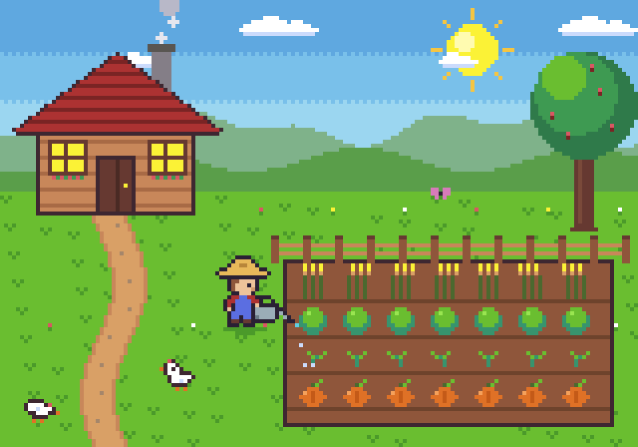

# Aseprite Claude Plugin

Claude draws and animates pixel art in [Aseprite](https://www.aseprite.org/), **live in the window you have open**. Each tool call appears on the canvas as it runs, and Ctrl+Z undoes one Claude step.



This plugin packages [diivi/aseprite-mcp](https://github.com/diivi/aseprite-mcp) (MIT), adds live mode on top of it, and includes pixel-art skills.

This page is the technical reference. For the overview, quick start, examples and troubleshooting, see the [main README](../../README.md).

## What's inside

```
.claude-plugin/
  plugin.json           plugin manifest
.mcp.json               starts the MCP server with uv
commands/               /pixel-new  /pixel-palette  /pixel-export  /pixel-setup  /pixel-help
skills/
  aseprite-live/        working in the user's open Aseprite window
  pixel-art/            planning, palette, passes, clean lines
  pixel-animation/      loops, pose-to-pose, seamless cycles
  pixel-dithering/      dithering, anti-aliasing, colour, materials (+ patterns.md)
  sprite-export/        PNG, GIF, spritesheets, JSON (+ engines.md: Unity, Godot, Phaser, GameMaker)
server/                 the Python MCP server (125 tools)
  aseprite_mcp/core/live.py     WebSocket bridge to the running Aseprite
  aseprite_mcp/extension/       Aseprite extension, installed automatically
```

## Install

You need:

- [Aseprite](https://www.aseprite.org/) 1.3 or later. The build must include WebSocket support, which the official builds do.
- [uv](https://docs.astral.sh/uv/).

Then run:

```
/plugin marketplace add OpenScaleOrg/Aseprite-Plugin
/plugin install aseprite@openscale
```

## First run

1. Start a Claude session. The server copies the **Aseprite MCP Live** extension into Aseprite's extensions folder.
2. Restart Aseprite once so it loads the extension.
3. The first time Claude works in the window, Aseprite asks whether the script may connect to the network or write files. Tick *Don't show this again* and allow it.
4. Ask Claude to check `live_status`, then to draw something.

## Commands

| Command | Example |
|---|---|
| `/pixel-new [size] [palette] [file]` | `/pixel-new icon pico8`, `/pixel-new 96x64 sweetie16` |
| `/pixel-palette <show\|set\|optimize\|ramp>` | `/pixel-palette set nes`, `/pixel-palette optimize 8` |
| `/pixel-export <png\|gif\|sheet\|json>` | `/pixel-export gif scale=6 bg=#1A1C2C` |
| `/pixel-setup [aseprite-path]` | Checks the connection and the executable, then runs a smoke test |
| `/pixel-help [topic]` | `/pixel-help export` |

Palette presets: `gameboy`, `cga`, `grayscale_4`, `monochrome`, `pico8`, `c64`, `sweetie16`, `dawnbringer16`, `dawnbringer32`, `nes`.

The commands, skill layout and size presets were inspired by [willibrandon/pixel-plugin](https://github.com/willibrandon/pixel-plugin) (MIT).

## How live mode works

```
Claude ── MCP ──▶ server ── ws://127.0.0.1:45654 ──▶ extension inside Aseprite
                                                     runs the script on the open sprite,
                                                     one undo step, redraws, saves
```

- **Live mode:** when Aseprite is connected, every tool's Lua script runs in that window on the matching tab.
- **Batch mode:** when Aseprite isn't connected, tools run a hidden Aseprite on the saved file, as the original server does.
- **Finding Aseprite:** the server looks for the executable in this order: `ASEPRITE_PATH`, the path the extension last reported, `PATH`, then common install locations.
- **Unsaved tabs:** call `save_active_sprite(path)` first. After that, every tool can target the tab by its path.

## Settings

All of these are environment variables.

| Variable | Default | Purpose |
|---|---|---|
| `ASEPRITE_PATH` | auto | The Aseprite executable used by batch-mode tools |
| `ASEPRITE_LIVE_PORT` | `45654` | The live bridge port. The extension's URL must match it. |
| `ASEPRITE_TIMEOUT_SECONDS` | `60` | How long a single tool call may run |
| `ASEPRITE_LIVE_MAX_LUA_LINES` | `40` | In live mode, the longest `run_lua_script` allowed, so Claude draws in visible steps |
